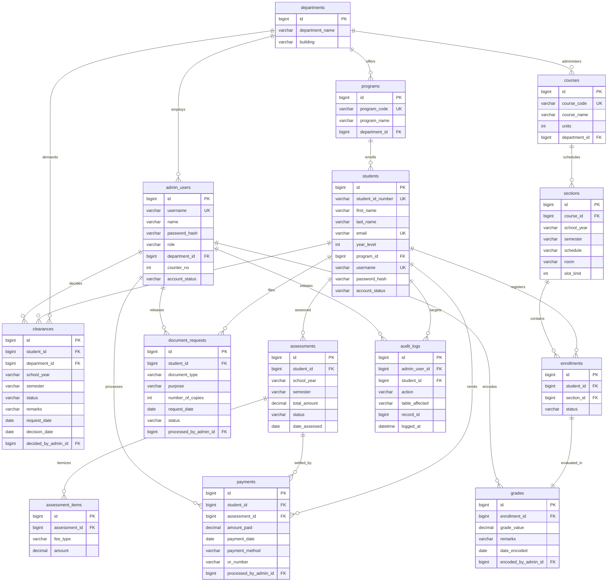

# CuyoTech University SSIS — Database Architecture & 3NF Normalization Report

This document provides a comprehensive academic and engineering specification of the relational database architecture powering the **CuyoTech University Student Services Information System (SSIS)**. It details table definitions, primary keys, foreign key constraints, data dictionaries, formal Third Normal Form (3NF) mathematical proofs, object-oriented domain relationships, and an Entity-Relationship Diagram (ERD).

---

## 1. Relational Database Specification

- **DBMS Engine:** MariaDB 10.4.32 / MySQL 8.0+
- **Default Storage Engine:** `InnoDB` (enforces ACID compliance, foreign key constraints, and row-level locking)
- **Character Set:** `utf8mb4`
- **Collation:** `utf8mb4_unicode_ci` (multilingual support and full unicode casing)
- **SQL Strict Mode:** `true` (`STRICT_TRANS_TABLES`, `NO_ENGINE_SUBSTITUTION`, `ERROR_FOR_DIVISION_BY_ZERO`)
- **Database Name:** `cuyotech_ssis`

---

## 2. Complete Data Dictionary (14 Core Entities)

### 2.1. `departments`
Stores academic colleges and administrative offices responsible for student clearances and academic governance.

| Column | Type | Nullable | Default | Key | Description |
| :--- | :--- | :---: | :---: | :---: | :--- |
| `id` | `BIGINT UNSIGNED` | NO | Auto Inc | **PK** | Surrogate primary identifier |
| `department_name` | `VARCHAR(255)` | NO | — | — | Official office or college title |
| `building` | `VARCHAR(255)` | YES | NULL | — | Campus building and facility locator |
| `created_at` | `TIMESTAMP` | YES | NULL | — | Record creation timestamp |
| `updated_at` | `TIMESTAMP` | YES | NULL | — | Last modification timestamp |

---

### 2.2. `programs`
Represents institutional degree programs offered by collegiate departments.

| Column | Type | Nullable | Default | Key | Description |
| :--- | :--- | :---: | :---: | :---: | :--- |
| `id` | `BIGINT UNSIGNED` | NO | Auto Inc | **PK** | Surrogate primary identifier |
| `program_code` | `VARCHAR(255)` | NO | — | **UK** | Program acronym (e.g. `BSCS`, `BSIT`) |
| `program_name` | `VARCHAR(255)` | NO | — | — | Full degree designation |
| `department_id` | `BIGINT UNSIGNED` | NO | — | **FK** | Foreign key references `departments.id` (`CASCADE`) |
| `created_at` | `TIMESTAMP` | YES | NULL | — | Record creation timestamp |
| `updated_at` | `TIMESTAMP` | YES | NULL | — | Last modification timestamp |

---

### 2.3. `courses`
Contains official curriculum catalog course descriptions, codes, and credit units.

| Column | Type | Nullable | Default | Key | Description |
| :--- | :--- | :---: | :---: | :---: | :--- |
| `id` | `BIGINT UNSIGNED` | NO | Auto Inc | **PK** | Surrogate primary identifier |
| `course_code` | `VARCHAR(255)` | NO | — | **UK** | Course subject code (e.g. `CCS109`) |
| `course_name` | `VARCHAR(255)` | NO | — | — | Descriptive course title |
| `units` | `INT` | NO | 3 | — | Academic credit units weight |
| `department_id` | `BIGINT UNSIGNED` | NO | — | **FK** | Foreign key references `departments.id` (`CASCADE`) |
| `created_at` | `TIMESTAMP` | YES | NULL | — | Record creation timestamp |
| `updated_at` | `TIMESTAMP` | YES | NULL | — | Last modification timestamp |

---

### 2.4. `sections`
Represents physical/scheduled class sections scheduled for academic courses per term.

| Column | Type | Nullable | Default | Key | Description |
| :--- | :--- | :---: | :---: | :---: | :--- |
| `id` | `BIGINT UNSIGNED` | NO | Auto Inc | **PK** | Surrogate primary identifier |
| `course_id` | `BIGINT UNSIGNED` | NO | — | **FK** | Foreign key references `courses.id` (`CASCADE`) |
| `school_year` | `VARCHAR(255)` | NO | `2025-2026` | — | Academic school year identifier |
| `semester` | `VARCHAR(255)` | NO | `Second Semester` | — | Academic term |
| `schedule` | `VARCHAR(255)` | NO | — | — | Days and time slots (e.g. `M/W 9:00–10:30`) |
| `room` | `VARCHAR(255)` | NO | `Online / TBA` | — | Physical classroom or computer lab |
| `slot_limit` | `INT` | NO | 40 | — | Maximum student capacity constraint |
| `created_at` | `TIMESTAMP` | YES | NULL | — | Record creation timestamp |
| `updated_at` | `TIMESTAMP` | YES | NULL | — | Last modification timestamp |

---

### 2.5. `students`
Stores permanent identity, enrollment program, academic level, and authentication credentials for students.

| Column | Type | Nullable | Default | Key | Description |
| :--- | :--- | :---: | :---: | :---: | :--- |
| `id` | `BIGINT UNSIGNED` | NO | Auto Inc | **PK** | Surrogate primary identifier |
| `student_id_number` | `VARCHAR(255)` | NO | — | **UK** | Official University Student ID (e.g. `2024-01847`) |
| `first_name` | `VARCHAR(255)` | NO | — | — | Student first name |
| `last_name` | `VARCHAR(255)` | NO | — | — | Student surname |
| `email` | `VARCHAR(255)` | NO | — | **UK** | Institutional email address |
| `year_level` | `INT` | NO | 1 | — | Academic year standing (1, 2, 3, 4) |
| `program_id` | `BIGINT UNSIGNED` | NO | — | **FK** | Foreign key references `programs.id` (`CASCADE`) |
| `username` | `VARCHAR(255)` | NO | — | **UK** | Student portal login handle |
| `password_hash` | `VARCHAR(255)` | NO | — | — | Bcrypt hash (hidden from API payloads) |
| `account_status` | `VARCHAR(255)` | NO | `Active` | — | Account lifecycle (`Active`, `Disabled`) |
| `created_at` | `TIMESTAMP` | YES | NULL | — | Record creation timestamp |
| `updated_at` | `TIMESTAMP` | YES | NULL | — | Last modification timestamp |

---

### 2.6. `admin_users`
Stores institutional university personnel (Registrar, Cashier, Department Staff, Admin).

| Column | Type | Nullable | Default | Key | Description |
| :--- | :--- | :---: | :---: | :---: | :--- |
| `id` | `BIGINT UNSIGNED` | NO | Auto Inc | **PK** | Surrogate primary identifier |
| `username` | `VARCHAR(255)` | NO | — | **UK** | Staff administrative login username |
| `name` | `VARCHAR(255)` | NO | — | — | Staff member full name |
| `password_hash` | `VARCHAR(255)` | NO | — | — | Bcrypt hash (hidden from API payloads) |
| `role` | `VARCHAR(255)` | NO | — | — | Assigned RBAC role |
| `department_id` | `BIGINT UNSIGNED` | YES | NULL | **FK** | Foreign key references `departments.id` (`SET NULL`) |
| `counter_no` | `INT` | YES | NULL | — | Terminal or physical service counter window |
| `account_status` | `VARCHAR(255)` | NO | `Active` | — | Account lifecycle status |
| `created_at` | `TIMESTAMP` | YES | NULL | — | Record creation timestamp |
| `updated_at` | `TIMESTAMP` | YES | NULL | — | Last modification timestamp |

---

### 2.7. `enrollments`
Junction entity linking a student to a class section for an academic term.

| Column | Type | Nullable | Default | Key | Description |
| :--- | :--- | :---: | :---: | :---: | :--- |
| `id` | `BIGINT UNSIGNED` | NO | Auto Inc | **PK** | Surrogate primary identifier |
| `student_id` | `BIGINT UNSIGNED` | NO | — | **FK** | Foreign key references `students.id` (`CASCADE`) |
| `section_id` | `BIGINT UNSIGNED` | NO | — | **FK** | Foreign key references `sections.id` (`CASCADE`) |
| `status` | `VARCHAR(255)` | NO | `Pending` | — | Status (`Pending`, `Approved`, `Rejected`, `For Review`) |
| `created_at` | `TIMESTAMP` | YES | NULL | — | Record creation timestamp |
| `updated_at` | `TIMESTAMP` | YES | NULL | — | Last modification timestamp |

---

### 2.8. `grades`
Records final academic performance evaluations encoded by faculty or registrars.

| Column | Type | Nullable | Default | Key | Description |
| :--- | :--- | :---: | :---: | :---: | :--- |
| `id` | `BIGINT UNSIGNED` | NO | Auto Inc | **PK** | Surrogate primary identifier |
| `enrollment_id` | `BIGINT UNSIGNED` | NO | — | **FK** | Foreign key references `enrollments.id` (`CASCADE`) |
| `grade_value` | `DECIMAL(4,2)` | NO | 0.00 | — | Numeric grade (1.00 to 5.00) |
| `remarks` | `VARCHAR(255)` | NO | `Passed` | — | Academic remark (`Passed`, `Failed`, `Incomplete`) |
| `date_encoded` | `DATE` | YES | NULL | — | Date grade was finalized |
| `encoded_by_admin_id` | `BIGINT UNSIGNED` | YES | NULL | **FK** | Foreign key references `admin_users.id` (`SET NULL`) |
| `created_at` | `TIMESTAMP` | YES | NULL | — | Record creation timestamp |
| `updated_at` | `TIMESTAMP` | YES | NULL | — | Last modification timestamp |

---

### 2.9. `document_requests`
Tracks student requests for institutional credentials (COR, TOR, Certifications).

| Column | Type | Nullable | Default | Key | Description |
| :--- | :--- | :---: | :---: | :---: | :--- |
| `id` | `BIGINT UNSIGNED` | NO | Auto Inc | **PK** | Surrogate primary identifier |
| `student_id` | `BIGINT UNSIGNED` | NO | — | **FK** | Foreign key references `students.id` (`CASCADE`) |
| `document_type` | `VARCHAR(255)` | NO | — | — | Document category (COR, TOR, Good Moral, etc.) |
| `purpose` | `VARCHAR(255)` | NO | — | — | Formal statement of intent / justification |
| `number_of_copies` | `INT` | NO | 1 | — | Requested copy quantity |
| `request_date` | `DATE` | NO | — | — | Date submitted |
| `status` | `VARCHAR(255)` | NO | `Pending` | — | Status (`Pending`, `Approved`, `Ready for Release`, `Released`) |
| `processed_by_admin_id` | `BIGINT UNSIGNED` | YES | NULL | **FK** | Foreign key references `admin_users.id` (`SET NULL`) |
| `created_at` | `TIMESTAMP` | YES | NULL | — | Record creation timestamp |
| `updated_at` | `TIMESTAMP` | YES | NULL | — | Last modification timestamp |

---

### 2.10. `assessments`
Represents the term tuition bill and assessment ledger header for a student.

| Column | Type | Nullable | Default | Key | Description |
| :--- | :--- | :---: | :---: | :---: | :--- |
| `id` | `BIGINT UNSIGNED` | NO | Auto Inc | **PK** | Surrogate primary identifier |
| `student_id` | `BIGINT UNSIGNED` | NO | — | **FK** | Foreign key references `students.id` (`CASCADE`) |
| `school_year` | `VARCHAR(255)` | NO | `2025-2026` | — | Academic school year |
| `semester` | `VARCHAR(255)` | NO | `Second Semester` | — | Academic term |
| `total_amount` | `DECIMAL(10,2)` | NO | 0.00 | — | Aggregate assessed tuition and institutional fees |
| `status` | `VARCHAR(255)` | NO | `Unpaid` | — | Settlement status (`Unpaid`, `Partial`, `Paid`) |
| `date_assessed` | `DATE` | NO | — | — | Date of fee computation |
| `created_at` | `TIMESTAMP` | YES | NULL | — | Record creation timestamp |
| `updated_at` | `TIMESTAMP` | YES | NULL | — | Last modification timestamp |

---

### 2.11. `assessment_items`
Child line items detailing specific fee breakdown categories within an assessment.

| Column | Type | Nullable | Default | Key | Description |
| :--- | :--- | :---: | :---: | :---: | :--- |
| `id` | `BIGINT UNSIGNED` | NO | Auto Inc | **PK** | Surrogate primary identifier |
| `assessment_id` | `BIGINT UNSIGNED` | NO | — | **FK** | Foreign key references `assessments.id` (`CASCADE`) |
| `fee_type` | `VARCHAR(255)` | NO | — | — | Fee title (Tuition, Lab Fee, Athletic, Library) |
| `amount` | `DECIMAL(10,2)` | NO | 0.00 | — | Fee item monetary value |
| `created_at` | `TIMESTAMP` | YES | NULL | — | Record creation timestamp |
| `updated_at` | `TIMESTAMP` | YES | NULL | — | Last modification timestamp |

---

### 2.12. `payments`
Financial transaction receipt records issued upon fee settlement at the Cashier counter.

| Column | Type | Nullable | Default | Key | Description |
| :--- | :--- | :---: | :---: | :---: | :--- |
| `id` | `BIGINT UNSIGNED` | NO | Auto Inc | **PK** | Surrogate primary identifier |
| `student_id` | `BIGINT UNSIGNED` | NO | — | **FK** | Foreign key references `students.id` (`CASCADE`) |
| `assessment_id` | `BIGINT UNSIGNED` | NO | — | **FK** | Foreign key references `assessments.id` (`CASCADE`) |
| `amount_paid` | `DECIMAL(10,2)` | NO | 0.00 | — | Actual monetary tender received |
| `payment_date` | `DATE` | NO | — | — | Date of transaction |
| `payment_method` | `VARCHAR(255)` | NO | `Cash` | — | Tender method (`Cash`, `Online`, `Bank`) |
| `or_number` | `VARCHAR(255)` | NO | — | — | Unique Official Receipt sequence number |
| `processed_by_admin_id` | `BIGINT UNSIGNED` | YES | NULL | **FK** | Foreign key references `admin_users.id` (`SET NULL`) |
| `created_at` | `TIMESTAMP` | YES | NULL | — | Record creation timestamp |
| `updated_at` | `TIMESTAMP` | YES | NULL | — | Last modification timestamp |

---

### 2.13. `clearances`
Tracks student clearance clearance approval and deficiency status across institutional offices.

| Column | Type | Nullable | Default | Key | Description |
| :--- | :--- | :---: | :---: | :---: | :--- |
| `id` | `BIGINT UNSIGNED` | NO | Auto Inc | **PK** | Surrogate primary identifier |
| `student_id` | `BIGINT UNSIGNED` | NO | — | **FK** | Foreign key references `students.id` (`CASCADE`) |
| `department_id` | `BIGINT UNSIGNED` | NO | — | **FK** | Foreign key references `departments.id` (`CASCADE`) |
| `school_year` | `VARCHAR(255)` | NO | `2025-2026` | — | Academic school year |
| `semester` | `VARCHAR(255)` | NO | `Second Semester` | — | Academic term |
| `status` | `VARCHAR(255)` | NO | `Pending` | — | Status (`Pending`, `Cleared`, `Deficient`) |
| `remarks` | `VARCHAR(255)` | YES | NULL | — | Deficiency notes or return requirements |
| `request_date` | `DATE` | NO | — | — | Date clearance requested |
| `decision_date` | `DATE` | YES | NULL | — | Date status finalized |
| `decided_by_admin_id` | `BIGINT UNSIGNED` | YES | NULL | **FK** | Foreign key references `admin_users.id` (`SET NULL`) |
| `created_at` | `TIMESTAMP` | YES | NULL | — | Record creation timestamp |
| `updated_at` | `TIMESTAMP` | YES | NULL | — | Last modification timestamp |

---

### 2.14. `audit_logs`
Immutable audit trail recording administrative and student operational events.

| Column | Type | Nullable | Default | Key | Description |
| :--- | :--- | :---: | :---: | :---: | :--- |
| `id` | `BIGINT UNSIGNED` | NO | Auto Inc | **PK** | Surrogate primary identifier |
| `admin_user_id` | `BIGINT UNSIGNED` | YES | NULL | **FK** | Foreign key references `admin_users.id` (`SET NULL`) |
| `student_id` | `BIGINT UNSIGNED` | YES | NULL | **FK** | Foreign key references `students.id` (`SET NULL`) |
| `action` | `VARCHAR(255)` | NO | — | — | Operation description |
| `table_affected` | `VARCHAR(255)` | NO | — | — | Target database entity |
| `record_id` | `BIGINT UNSIGNED` | YES | NULL | — | Target record primary key |
| `logged_at` | `DATETIME` | NO | — | — | Audit timestamp |
| `created_at` | `TIMESTAMP` | YES | NULL | — | System record creation timestamp |
| `updated_at` | `TIMESTAMP` | YES | NULL | — | System record modification timestamp |

---

## 3. Formal Normalization Proof (1NF, 2NF, 3NF Compliance)

A relational schema is in **Third Normal Form (3NF)** if and only if it is in **Second Normal Form (2NF)** and no non-prime attribute is transitively dependent on any candidate key.

### 3.1. First Normal Form (1NF) Compliance
**Condition:** Each attribute must contain only atomic (indivisible) values, and no attribute may contain repeating groups or multi-valued arrays. A primary key must be defined for every relation.

*Proof for CuyoTech SSIS:*
1. **Atomicity:** Attributes such as `first_name` and `last_name` are decomposed into distinct scalar strings rather than a composite `full_name` attribute. Monies (`amount`, `total_amount`) are declared as scalar `DECIMAL(10,2)` types.
2. **Elimination of Repeating Groups:** Instead of storing multiple courses or fees inside comma-separated text strings or enumerated arrays inside `students` or `assessments`, separate relations are formed (`enrollments`, `assessment_items`).
3. **Primary Keys:** Every relation defines a surrogate primary key (`id BIGINT UNSIGNED AUTO_INCREMENT`) enforcing tuple uniqueness.

### 3.2. Second Normal Form (2NF) Compliance
**Condition:** The relation is in 1NF, and every non-prime attribute is fully functionally dependent on the primary key (no partial dependencies on a composite candidate key).

*Proof for CuyoTech SSIS:*
1. All core relations utilize single-column surrogate primary keys (`id`).
2. Mathematically, if $K = \{id\}$ is the candidate key, any proper subset of $K$ is the empty set $\emptyset$. Because no non-trivial functional dependency $X \rightarrow Y$ can exist where $X \subset K$, **partial dependencies are mathematically impossible** across all single-column primary key tables.
3. In associative entities (`enrollments`, `clearances`), foreign keys (`student_id`, `section_id`, `department_id`) are attributes functionally dependent on the single surrogate `id`.

### 3.3. Third Normal Form (3NF) Compliance
**Condition:** The relation is in 2NF, and for every non-trivial functional dependency $X \rightarrow Y$, either:
1. $X$ is a superkey, or
2. $Y$ is a prime attribute (part of a candidate key).

In informal terms, *every non-key attribute must depend directly on the primary key, the whole primary key, and nothing but the primary key* (eliminating transitive dependencies $PK \rightarrow X \rightarrow Y$).

*Proof across CuyoTech SSIS Entities:*
1. **`students`**:
   - Dependencies: `id -> {student_id_number, first_name, last_name, email, year_level, program_id, username, password_hash}`.
   - `program_id` references `programs`. The program name and department are *not* stored in `students`, eliminating $student \rightarrow program\_id \rightarrow program\_name$.
2. **`programs`**:
   - Dependencies: `id -> {program_code, program_name, department_id}`.
   - Department building and name are *not* stored here; they are resolved via foreign key `department_id`.
3. **`courses` & `sections`**:
   - Course credit units and course name belong to `courses.id`.
   - `sections` stores only the section schedule, room, and capacity for a given `course_id`. Units and course titles are not transitively stored in `sections`.
4. **`enrollments` & `grades`**:
   - An enrollment links `student_id` and `section_id`.
   - `grades` isolates the performance evaluation (`grade_value`, `remarks`) dependent solely on `enrollment_id`. Course details are not duplicated in `grades`.
5. **`assessments` & `assessment_items`**:
   - `assessments` holds term billing metadata (`student_id`, `school_year`, `semester`, `total_amount`).
   - Line items with distinct `fee_type` and `amount` are stored in `assessment_items`, preventing transitive dependency across multiple fee columns.
6. **`clearances`**:
   - Links `student_id` and `department_id`. Staff approver (`decided_by_admin_id`) references `admin_users` without duplicating staff names or roles.

**Conclusion:** The database satisfies **1NF, 2NF, and 3NF** criteria without data redundancy or update/deletion anomalies.

---

## 4. Object-Oriented Domain Relationships

| Relationship Type | Source Entity | Target Entity | Multiplicity | Architectural Justification |
| :--- | :--- | :--- | :---: | :--- |
| **Composition** | `Assessment` | `AssessmentItem` | `1 : N` | Strong lifecycle binding. Assessment line items cannot exist without their parent Assessment header. On delete cascade is enforced. |
| **Composition** | `Enrollment` | `Grade` | `1 : 1` | A grade evaluation belongs strictly to a specific course enrollment instance. |
| **Composition** | `Course` | `Section` | `1 : N` | A class section cannot exist independently of its master Course catalog definition. |
| **Aggregation** | `Department` | `Program` | `1 : N` | A Department groups related academic Programs. |
| **Aggregation** | `Department` | `AdminUser` | `1 : N` | A Department aggregates institutional staff; staff accounts can exist independently or be reassigned. |
| **Aggregation** | `Program` | `Student` | `1 : N` | A Program aggregates enrolled students. |
| **Association** | `Student` | `DocumentRequest` | `1 : N` | Behavioral action: A Student initiates requests for credentials. |
| **Association** | `Student` | `Assessment` | `1 : N` | Transactional relationship: Accounts ledger tracks student assessments per term. |
| **Association** | `Student` | `Payment` | `1 : N` | Financial transaction: A student remits cash/fees resulting in an official receipt. |
| **Association** | `AdminUser` | `Payment` | `1 : N` | Cashier operational association: Staff processes and issues receipts. |
| **Association** | `AdminUser` | `Clearance` | `1 : N` | Clearance officer operational association: Staff verifies and approves status. |
| **Association** | `AdminUser` | `AuditLog` | `1 : N` | Governance association: Records accountability for actions taken by users. |

---

## 5. Entity-Relationship Diagram (Mermaid ERD)

---

## 6. Visual Inspection & Live Demonstration in phpMyAdmin

The `cuyotech_ssis` database is optimized for live evaluation, academic grading, and visual relationship inspection inside **phpMyAdmin** (`http://localhost/phpmyadmin`).

### 6.1. Visual ERD via phpMyAdmin Designer
1. Launch **XAMPP Control Panel** and ensure **Apache** and **MySQL** are running.
2. Navigate to `http://localhost/phpmyadmin` in your web browser.
3. Select the **`cuyotech_ssis`** database from the left-hand navigation sidebar.
4. On the top tab bar, click **More** (or the chevron `»`) and select **Designer**.
5. **Live Foreign Key Canvas:** phpMyAdmin will render an interactive canvas displaying all 14 core tables with visual lines connecting every `FOREIGN KEY` to its parent `PRIMARY KEY`:
   - `students.id` $\leftrightarrow$ `enrollments.student_id`, `assessments.student_id`, `payments.student_id`, `clearances.student_id`, `document_requests.student_id`
   - `departments.id` $\leftrightarrow$ `programs.department_id`, `courses.department_id`, `clearances.department_id`, `admin_users.department_id`
   - `assessments.id` $\leftrightarrow$ `assessment_items.assessment_id`, `payments.assessment_id`
   - `enrollments.id` $\leftrightarrow$ `grades.enrollment_id`
   - `sections.id` $\leftrightarrow$ `enrollments.section_id`
   - `courses.id` $\leftrightarrow$ `sections.course_id`
   - `admin_users.id` $\leftrightarrow$ `grades.encoded_by_admin_id`, `payments.processed_by_admin_id`, `clearances.decided_by_admin_id`, `document_requests.processed_by_admin_id`

### 6.2. Clickable Relational Navigation (Browse Mode)
Because true `InnoDB` foreign keys are enforced:
1. Open the **`payments`** or **`clearances`** table in phpMyAdmin and click **Browse**.
2. Hover over any value in `student_id` (e.g., `1`, `2`, `3`). It displays as a blue clickable hyperlink.
3. Clicking the link instantly jumps to that exact student record in the `students` table.
4. Clicking `assessment_id` jumps directly to the matching tuition billing record in `assessments`.

### 6.3. Constraint Inspection (Relation View)
1. Select any child table (e.g. `clearances`, `grades`, or `assessment_items`).
2. Click the **Structure** tab, then click **Relation view** right above the columns.
3. phpMyAdmin displays the exact foreign key constraints with:
   - Foreign key constraint name (e.g. `clearances_student_id_foreign`)
   - Target database: `cuyotech_ssis`
   - Target table: `students` (`id`)
   - `ON DELETE`: `CASCADE`
   - `ON UPDATE`: `CASCADE`

### 6.4. Protection from Automated Testing Data Wipes
Automated feature and regression tests (`php vendor/bin/phpunit`, `php artisan test`) are configured in `phpunit.xml` to execute against an isolated in-memory SQLite database (`:memory:`). Running tests will **never wipe, truncate, or overwrite** the live demo data inside `cuyotech_ssis` in phpMyAdmin.

