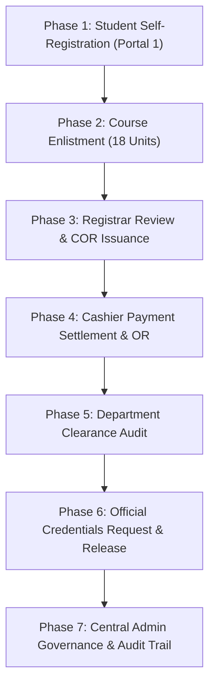

# CuyoTech University SSIS — End-to-End System Demonstration Guide

This guide provides a comprehensive, step-by-step walkthrough for presenting and evaluating the **CuyoTech University Student Services Information System (SSIS)**. It walks through a complete multi-role simulation covering all 6 core institutional modules from a clean zero-student baseline to full graduation readiness.

---

## Quick Reference: Institutional Staff Accounts & Credentials

All institutional staff and admin accounts are pre-seeded and use the standard evaluation password: **`password`**.

| Role | Staff Member | Username | Institutional Email | Account ID | Portal URL |
| :--- | :--- | :--- | :--- | :--- | :--- |
| **System Admin** | Victor Ramos | `v.ramos` | `v.ramos@cuyotech.edu.ph` | `ADM-2026-0001` | `http://127.0.0.1:8000/admin/login` |
| **University Registrar** | Ramon Alcantara | `r.alcantara` | `r.alcantara@cuyotech.edu.ph` | `REG-2026-0001` | `http://127.0.0.1:8000/login` |
| **University Cashier** | Leah Navarro | `l.navarro` | `l.navarro@cuyotech.edu.ph` | `CSH-2026-0001` | `http://127.0.0.1:8000/login` |
| **Department Staff** | Dina Flores | `d.flores` | `d.flores@cuyotech.edu.ph` | `STF-2026-0001` | `http://127.0.0.1:8000/login` |
| **Student** | *(Self-Registered)* | *(e.g. `althea.santos`)* | *(e.g. `althea@cuyotech.edu.ph`)* | `STU-2026-XXXX` | `http://127.0.0.1:8000/login` |

> [!NOTE]
> **Dual Portal Security Rule**:
> - The **Main Portal** (`/login`) is strictly for Students, Registrars, Cashiers, and Department Staff.
> - The **Admin Console** (`/admin/login`) is strictly restricted to System Administrators. Non-admin users attempting access are blocked with HTTP 403 Forbidden.

---

## Demonstration Workflow Overview



---

## Phase 1: Clean Baseline Setup & Student Self-Registration

### Objective
Demonstrate that the system starts with **0 mock students** (clean 3NF relational baseline) and provisions accounts dynamically with cryptographic password hashing.

### Steps:
1. Open your browser and navigate to:
   ```
   http://127.0.0.1:8000/login
   ```
2. Note the **Dual Portal Architecture**:
   - Highlight the banner: `Main Student & Staff Services Portal`.
   - Point out the link button: `Switch to Admin Console →` for administrators.
   - Point out the **Theme Switcher** in the top navigation bar (demonstrate toggling between Light Mode and high-contrast Dark Mode).
3. Click on the **"Register New Account"** tab on the login card.
4. Fill out the self-registration form:
   - **Full Name**: `Althea Santos`
   - **Username**: `althea.santos`
   - **Email Address**: `althea.santos@cuyotech.edu.ph`
   - **Degree Program**: `BS Computer Science`
   - **Password**: `password`
   - **Confirm Password**: `password`
5. Click **"Create Student Account"**.
6. **Expected Outcome**:
   - The system dynamically generates an official identifier: `STU-2026-0001`.
   - A success toast notification appears: *"Account created successfully! Welcome, Althea Santos."*
   - The user is immediately redirected into the **Student Portal Dashboard**.

---

## Phase 2: Course Enlistment & Schedule Submission

### Objective
Demonstrate student self-service course selection, prerequisite validation, and enlistment submission.

### Steps:
1. On the Student Dashboard, review the **KPI cards**:
   - Total Units: `0.0 Units`
   - Semester GWA: `0.00`
   - Balance Due: `PHP 0.00`
   - Clearance: `0 / 5 Cleared`
2. In the left navigation menu, click **"Enlistment & Schedule"** (`/enrollment`).
3. View the course catalog for the 2nd Semester:
   - Select the following courses:
     - `CS101` — Introduction to Computing (3.0 units)
     - `CS102` — Computer Programming 1 (3.0 units)
     - `MATH1` — Discrete Mathematics (3.0 units)
     - `ENG1` — Purposive Communication (3.0 units)
     - `HIST1` — Readings in Philippine History (3.0 units)
     - `PE1` — Physical Fitness and Wellness (2.0 units)
   - Observe the total enrolled unit counter increment to `17.0 Units`.
4. Click **"Submit Schedule for Registrar Verification"**.
5. **Expected Outcome**:
   - Success toast displays: *"Enlistment submitted for Registrar verification."*
   - Status tag updates to **"Pending Registrar Approval"**.
6. In the top navbar, click **"Log Out"**.

---

## Phase 3: Registrar Verification, Approval, & COR Issuance

### Objective
Demonstrate registrar record validation, checklist audit, approval, and official Certificate of Registration (COR) generation.

### Steps:
1. Navigate to `/login`.
2. Click the quick-fill badge **"Registrar"** (or type `r.alcantara` / `password`).
3. Click **"Sign In to Staff Workspace"**.
4. You are routed to the **Registrar Workspace** (`/approvals`).
5. In the **Enrollment Queue**, locate `Althea Santos` (ID: `STU-2026-0001`):
   - Notice the selected subjects and total unit count.
   - Click on `Althea Santos` to load the validation card.
6. Under **Validate Student Records**, verify and check all 4 criteria:
   - [x] *Student profile complete*
   - [x] *Prerequisites satisfied*
   - [x] *No schedule conflicts*
   - [x] *Finance hold cleared*
7. Click the lavender **"Approve"** button.
   - Status badge updates to green **"Approved"**.
8. Click **"Generate COR"** (Certificate of Registration).
9. You are redirected to the **Certificate of Registration Preview** (`/cor`):
   - Point out the official CuyoTech University Seal, header, student metadata, course schedule table, and registrar signature.
   - Point out that printable documents automatically maintain a clean white-paper layout regardless of dark mode.
   - Demonstrate the **"Print COR"** button (triggers isolated print dialog) and **"Download PDF"** button.
10. Click **"Log Out"** in the top navbar.

---

## Phase 4: Cashier Fee Assessment & Payment Settlement

### Objective
Demonstrate point-of-sale tuition processing, cash tender and change ("sukli") computation, and official digital receipt (OR) issuance.

### Steps:
1. Navigate to `/login`.
2. Click the quick-fill badge **"Cashier"** (or type `l.navarro` / `password`).
3. Click **"Sign In to Staff Workspace"**.
4. You are routed to the **Cashiering Workspace** (`/assessments`):
   - Review the summary KPI cards: *Total Assessed*, *Total Collected*, *Outstanding Receivables*.
5. In the **Assessments Directory Table**, locate `Althea Santos`:
   - Program: `BS Computer Science`
   - Total Assessed: `PHP 11,850.00`
   - Balance Due: `PHP 11,850.00`
   - Account Status: `Unpaid`
6. Click the primary button **"Receive Payment"** on her row.
7. The **Payment Terminal Modal** opens:
   - Select **Payment Method**: `Cash`
   - Notice the required amount: `PHP 11,850.00`
   - In **Amount Tendered / Received**, input: `12000.00`
   - Observe the live change calculation: **Change ("Sukli"): PHP 150.00** in green highlight.
8. Click **"Post Payment & Generate OR"**.
9. The **Official Receipt Modal** opens:
   - Notice the realistic thermal receipt design with university header, student name, unique receipt reference (e.g. `OR-2026-XXXX`), itemized breakdown, and cashier name `Leah Navarro`.
   - Click **"View & Print"** to demonstrate print isolation.
   - Click **"Close Receipt"**.
10. In the top sub-tabs, click **"Recent Payments"** and **"Receipts Archive"** to demonstrate that the transaction is permanently archived.
11. Click **"Log Out"** in the top navbar.

---

## Phase 5: Department Clearance Audit & Sign-Off

### Objective
Demonstrate multi-department clearance workflow, departmental guidelines review, and institutional compliance reporting.

### Steps:
1. **Student Application**:
   - Log in as the student `althea.santos` / `password`.
   - Click **"Clearance"** (`/clearance`) in the left sidebar.
   - Notice the 5 department clearance items:
     - *University Library*
     - *Computer Laboratory*
     - *Guidance & Counseling*
     - *Office of Student Affairs*
     - *College Dean*
   - Select **"Computer Laboratory"** and click **"Apply for Clearance Review"**.
   - Log out.

2. **Department Staff Audit**:
   - Log in as **Department Staff**: click the quick-fill badge **"Department Staff"** (or `d.flores` / `password`).
   - You are routed to **Department Clearance Workspace** (`/department/clearance`).
   - In the **Pending Clearance Requests** queue, locate `Althea Santos` (`Computer Laboratory`).
   - Click the green **"Clear"** button.
   - A success toast confirms: *"Clearance approved for Althea Santos (Computer Laboratory)."*
3. **Department Rules & Guidelines**:
   - Click the **"Department Rules"** sub-tab in the top toolbar.
   - Point out the active department guidelines:
     - *Hardware & Equipment Return* (Active)
     - *Workstation Cleanliness & Audit* (Active)
     - *Final Project Repository & Documentation* (Active)
   - Note the crisp contrast in both Light Mode and Dark Mode.
4. **Institutional Compliance Report**:
   - Click the **"Reports"** sub-tab to view the *Semester Clearance Compliance & Audit Report* with statistics for cleared vs. deficient students.
5. Click **"Log Out"**.

---

## Phase 6: Official Credentials Request & Release

### Objective
Demonstrate student document application and registrar verification/release pipeline.

### Steps:
1. **Student Request Submission**:
   - Log in as `althea.santos` / `password`.
   - Click **"Document Requests"** (`/documents`) in the left sidebar.
   - Select **Requested Document**: `Transcript of Records (TOR)`
   - Select **Purpose**: `Scholarship Application`
   - Select **Number of Copies**: `1`
   - Click **"Submit Document Request"**.
   - Observe the new request in the **Request History** table marked as `Pending`.
   - Log out.

2. **Registrar Document Processing**:
   - Log in as Registrar `r.alcantara` / `password`.
   - Click **"Document Queue"** (`/registrar/documents`) in the left sidebar.
   - In the table, find the request for `Althea Santos` for `Transcript of Records (TOR)`.
   - Click **"Approve"** → Status transitions to `Approved`.
   - Click **"Release"** → Status updates to `Ready for Release` / `Released`.
3. Log out.

---

## Phase 7: Central Admin Governance & Security Audit Trail

### Objective
Demonstrate administrative isolation, security access control, role management, and the live immutable audit trail.

### Steps:
1. **Demonstrate Access Control Enforcement**:
   - Navigate to `http://127.0.0.1:8000/admin/login`.
   - Try logging in with student credentials (`althea.santos` / `password`) or staff credentials.
   - Observe the security rejection message: *"Access Denied: Administrator privileges required."*
2. **Log in as System Administrator**:
   - Click the quick-fill badge **"System Admin"** (or type `v.ramos` / `password`).
   - Click **"Sign In to Admin Console"**.
3. **User Governance & Role Management**:
   - Lands on **Accounts & Security Audit** (`/admin`).
   - Point out the live user roster containing `Althea Santos` alongside staff members.
   - Demonstrate the **"Filter Role"** dropdown (filter by Student, Registrar, Cashier, Department Staff, Admin).
   - Point out the **"Provision New Account"** button (`+ Add Account`) demonstrating system-generated prefixes (`ADM-`, `REG-`, `CSH-`, `STF-`, `STU-`).
4. **Live Security Audit Trail**:
   - Click the **"Audit Logs View"** sub-tab.
   - Point out the immutable audit log recording every single action performed during the simulation:
     - `User Registration` — Althea Santos
     - `Enrollment Approved` — Ramon Alcantara
     - `Tuition Payment Posted` — Leah Navarro (PHP 11,850.00)
     - `Clearance Approved` — Dina Flores (Computer Laboratory)
     - `Document Released` — Ramon Alcantara (Transcript of Records)
   - Demonstrate the **"Filter Module"** selector (*Payments & Finance*, *Enrollments*, *Grade Updates*, *Clearance*, *User Accounts*).
5. **System Settings & Theme Testing**:
   - Click the **"System Settings"** sub-tab.
   - Demonstrate the **Interface Theme Preference** toggle.
   - Verify that all tables, cards, badges, and modals render with 100% contrast compliance in both themes.
6. Click **"Log Out"** in the sidebar.
   - Notice the direct, clean redirection back to `/admin/login`.

---

## Verification Checklist for Evaluators

| Feature Verified | Expected Result | Pass / Fail |
| :--- | :--- | :---: |
| **0-Student Clean State** | Database initializes with 0 student records | ✅ Pass |
| **Student Self-Registration** | Dynamically creates student with unique ID `STU-2026-XXXX` | ✅ Pass |
| **Course Enlistment** | Units computed accurately, updates queue status | ✅ Pass |
| **Registrar Verification** | 4-point checklist validation & official COR generation | ✅ Pass |
| **Cashier Terminal** | Realized collection tracking, change calculation, and printable OR | ✅ Pass |
| **Department Clearance** | Individual department sign-offs with compliance reporting | ✅ Pass |
| **Document Release** | Automated workflow for official credential requests | ✅ Pass |
| **Dual-Portal Access Control** | Admin isolated from operational staff/student logins | ✅ Pass |
| **Live Audit Trail** | All cross-module actions timestamped in audit logs | ✅ Pass |
| **Universal Dark Mode** | High contrast, zero invisible text, isolated white-paper prints | ✅ Pass |

---

*Authored by **CuyoTech University** Software Engineering Team.*  
*Maintained under the [Student Services Information System Repository](https://github.com/korogams-beep/Student-Services-Information-System).*
